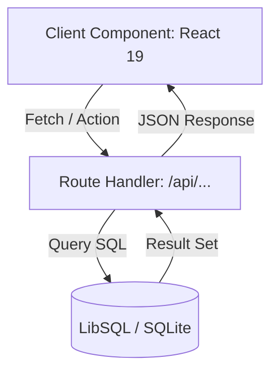

# 🛠️ Documento de Diseño Técnico (SDD): [Nombre de la Funcionalidad]

- **ID de Diseño**: `DESIGN-XXX`
- **Especificación Relacionada**: [Link a spec.md](./spec.md)
- **Autor(es)**: [Nombre o Agente]
- **Estado**: `[Borrador | Propuesto | Aprobado | Deprecado]`
- **Fecha**: YYYY-MM-DD

---

## 1. 🏛️ Arquitectura General de la Solución
> Descripción de alto nivel de cómo interactúan el cliente (Next.js), el backend (Route Handlers / Server Actions) y la base de datos (SQLite / LibSQL).



---

## 2. 🗄️ Modelo de Datos y Cambios en Base de Datos

### 2.1 Tablas Involucradas / Nuevas Tablas
Si se requieren cambios en `schema.db` o nuevas consultas:

```sql
-- Ejemplo de consulta o migración propuesta
ALTER TABLE Jugadores ADD COLUMN nuevoCampo TEXT;
```

### 2.2 Integridad y Relaciones
- Llaves foráneas (`FOREIGN KEY`)
- Restricciones de unicidad o no nulos (`NOT NULL`, `UNIQUE`)
- Índices requeridos para optimizar filtros y ordenamientos

---

## 3. 🌐 Contratos de API (Endpoints / Handlers)

### `GET /api/[recurso]`
- **Descripción**: Obtiene la lista de elementos filtrados.
- **Parámetros**: `?equipoId=1&temporada=2026`
- **Respuesta Exitosa (200 OK)**:
```json
{
  "success": true,
  "data": []
}
```

### `POST /api/[recurso]`
- **Descripción**: Crea un nuevo registro.
- **Payload Request**:
```json
{
  "nombre": "Ejemplo",
  "idCategoria": 1
}
```
- **Respuestas**:
  - `201 Created`: Registro creado.
  - `400 Bad Request`: Error de validación en los campos.
  - `500 Internal Server Error`: Fallo en la base de datos.

---

## 4. 🧩 Jerarquía de Componentes UI (Next.js 16 + React 19)

| Componente | Tipo (`Server` / `Client`) | Responsabilidad |
|---|---|---|
| `app/[modulo]/page.js` | Server Component | Fetch inicial de datos y renderizado SSR |
| `components/[Modulo]Form.js` | Client Component (`'use client'`) | Gestión de estado del formulario e interacción |
| `components/[Modulo]Chart.js` | Client Component (`'use client'`) | Renderizado de gráficos con `react-chartjs-2` |

> ⚠️ **Atención Next.js 16**: Los `params` dinámicos son asíncronos (`const { id } = await params;`).

---

## 5. 🛡️ Manejo de Errores, Estados Borde y Seguridad
- **Carga (Loading)**: Skeletons visuales mientras se resuelve la consulta de datos.
- **Sin datos (Empty State)**: Componente ilustrado amigable cuando el filtro o la consulta no retorna filas.
- **Validación de Inputs**: Sanitización de entradas antes de la ejecución de queries parametrizadas (prevención de SQL Injection).
- **Seguridad**: Verificar variables de entorno sensibles (`TURSO_AUTH_TOKEN`).

---

## 6. ⚖️ Alternativas Consideradas y Trade-offs
- **Alternativa A**: [Descripción y por qué se descartó]
- **Alternativa B Elegida**: [Descripción y justificación técnica]

